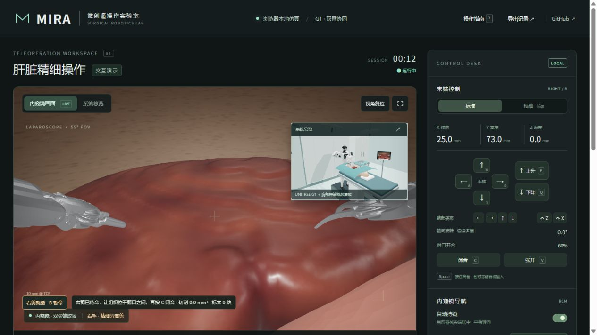
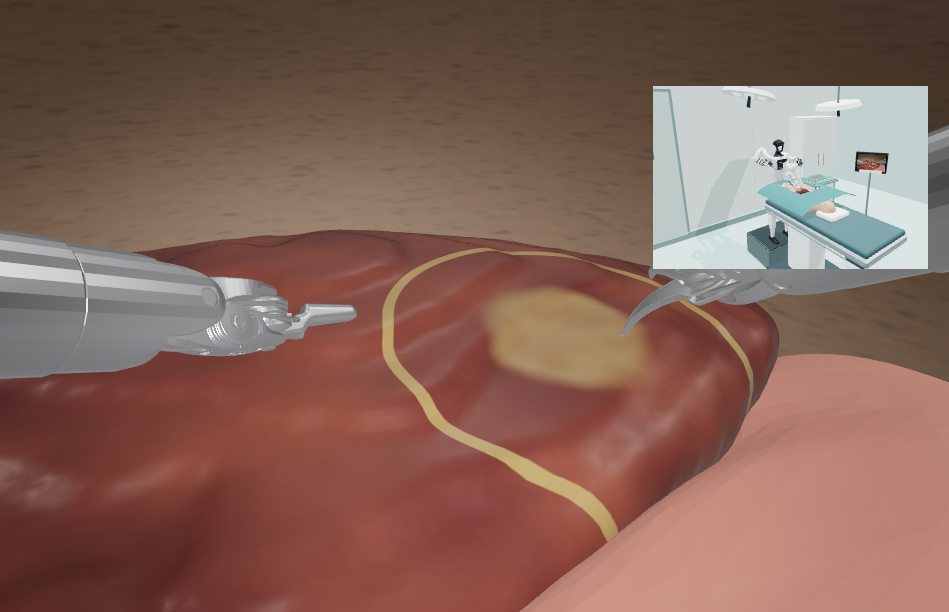
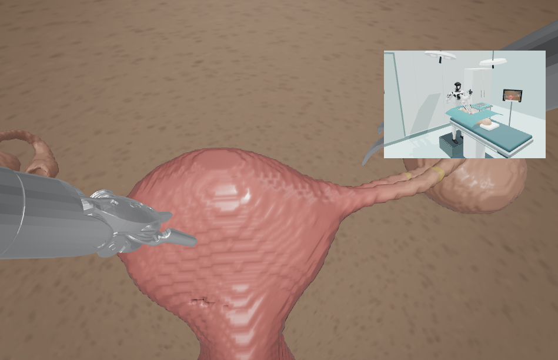
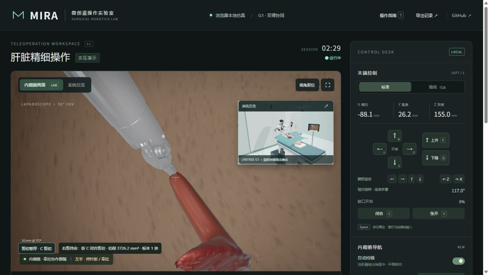
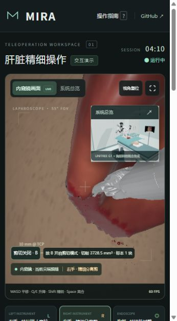

# MIRA · 微创遥操作实验室

MIRA 是一个可以直接在浏览器里操作的双臂遥操作演示。你可以控制左边的夹钳和右边的剪刀，试着夹起一小块组织、剪断连接，再把它移开。

第一次使用，先看一遍页面里的示范，再照着下面的步骤自己操作就好。

[**打开网页，开始操作 →**](https://wu-make.github.io/surgical-teleop/)

[](https://wu-make.github.io/surgical-teleop/)

## 先认识一下界面

- **左侧大画面**是内窥镜视角，用来看夹钳、剪刀和组织的接触位置。
- **右上角小窗**是系统总览，可以看到机器人、器械和手术台的位置。点击小窗的箭头，就能把它换到大画面。
- **右侧面板**可以选择器械、移动、开合和调整镜头。暂时记不住按键时，直接用面板上的按钮也可以。

## 换一个手术场景

在画面左上方、视图切换旁边选择 **正常肝脏、病灶肝或子宫附件**。切换后，组织、双臂和镜头会一起复位。

病灶场景里，浅褐色部分是目标，金色细线是切缘参考。**「沿缘辅助」默认开启**：按住 C，沿切缘大致移动，靠近时剪口会轻微贴合曲线，不需要逐点对齐。想完全手动操作，点一下这个开关即可。病灶要随着组织真正切离、移开，面板会显示它还连接在母体上，还是已随标本分离。

| 病灶肝 · 左半肝 | 子宫附件 · 左侧病灶 |
| --- | --- |
|  |  |

## 第一次打开，先看一遍示范

用电脑浏览器[打开网页](https://wu-make.github.io/surgical-teleop/)，等模型加载完成，然后点击画面下方的 **「切离与移开示范」**。

示范会依次完成夹住组织、牵拉、切断连接和移开。留意左钳和右剪各自的动作，以及右侧面板上的变化。想自己接着操作，直接使用键盘即可；想从头试一次，按 **R** 重置。

## 跟着做一次：夹住、剪下、移开

### 1. 用左钳夹住组织

按 **1** 选择左钳，点击 **「当前器械表面就位」**，让钳尖靠近组织，再按住 **C**，直到钳口闭合夹住。

### 2. 轻轻抬起

按 **E** 抬起，按 **Q** 降低。**WASD** 可以前后左右移动，按住 **Shift** 会放慢动作，方便一点点调整。先抬起一小段，观察组织怎样跟着钳尖移动。

### 3. 换右剪剪断连接

按 **2** 选择右剪。左钳会保持夹持，你可以把剪口移到被牵起组织的连接处，按住 **C** 闭合剪口并配合移动剪切，直到组织块完全切离。松开 **C** 后移动只调整位置；按 **V** 张开剪口。

### 4. 把组织块移开，再放下

按 **1** 切回左钳，用 **E** 抬起，或用 **WASD** 移开。按住 **V** 张开钳口，组织块就会落下。

切下来的组织块在面板中叫作 **「标本」**。想再夹起来，点击 **「左钳接近标本」**，等钳尖就位后按 **C**。



*左钳夹持切离后的组织块。可以继续搬运、旋转，也可以松钳后重新夹取。*

<details>
<summary>查看切面近景</summary>

<p align="center">
  
</p>

切离后，可以从内窥镜画面观察组织块和切面，也可以切换到系统总览看整体位置。

</details>

## 再试试镜头和局部压迫

**调整观察位置：** 默认开启「自动持镜」，镜头会跟随当前操作的器械尖端。想自己看周围，按 **F** 关闭自动持镜，再在画面上拖动鼠标转向，滚轮缩放视野。按 **[ / ]** 可以让镜头后退或前进。

**观察出血和局部压迫：** 切离后，点击 **「右端接近渗血切面」**。等器械就位后，按住 **H**，观察接触部位的渗血变化；松开后继续观察切口。血液保留在切面，不会向完整组织蔓延。

**暂停看看：** 按 **P** 暂停，可以慢慢看当前画面。右侧的「单步 0.05 s」能逐步观察组织和血液的变化，再按 **P** 继续。

## 常用按键

先记住 **1 / 2 选器械、WASD 移动、C / V 开合、Shift 放慢、R 重来**，其他按键需要时再查。移动、旋转和开合都可以按住持续操作，轻点则用于微调。

| 按键 | 用途 |
| --- | --- |
| **1 / 2 / 3** | 选择左钳 / 右剪 / 内窥镜 |
| **WASD** | 前后左右移动 |
| **Q / E** | 降低 / 抬起 |
| **C / V** | 闭合 / 张开钳口 |
| **Shift** | 按住放慢动作，进行精细调整 |
| **方向键** · **Z / X** | 调整腕部方向 · 沿器械轴线旋转 |
| **F** · **[ / ]** | 开关自动持镜 · 镜头后退 / 前进 |
| **H**（按住） | 接触切面后进行局部压迫 |
| **Ctrl Z / Ctrl Y** | 撤销 / 重做 |
| **P** · **Tab** | 暂停或继续 · 交换主画面与小窗 |
| **R** | 恢复完整器官、双臂和镜头的起始状态 |

网页右上角的 **「操作指南」** 随时可以打开。右剪在初始状态下已经就绪，选好位置后直接按 **C** 就能操作。

<details>
<summary>在自己的电脑上运行项目</summary>

日常使用可以直接访问在线演示。如果想修改代码，安装 Node.js 22.12 或更高版本后，在终端执行：

```sh
git clone https://github.com/wu-make/surgical-teleop.git
cd surgical-teleop
npm ci
npm run dev
```

随后打开终端显示的本地地址。

```sh
npm test          # 运行测试
npm run build    # 构建静态网站
npm run preview  # 预览构建结果
```

更多实现说明见 [开发文档](docs/DEVELOPMENT-NOTES.md)。

</details>

## 许可与致谢

场景使用了 Unitree G1 / Z1、dVRK 器械和 BodyParts3D 解剖模型，感谢这些公开项目提供的资产。

项目代码采用 [MIT 许可](LICENSE)。各模型的来源、署名和许可见 [资产说明](public/assets/ATTRIBUTION.md)。
